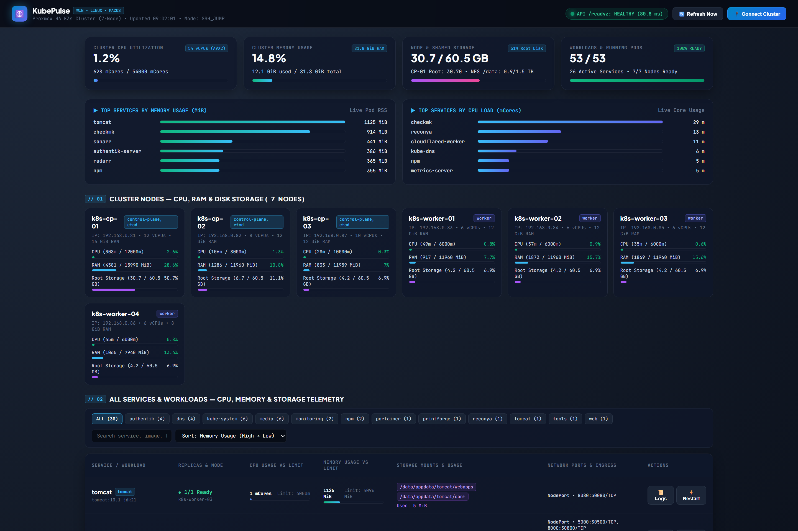
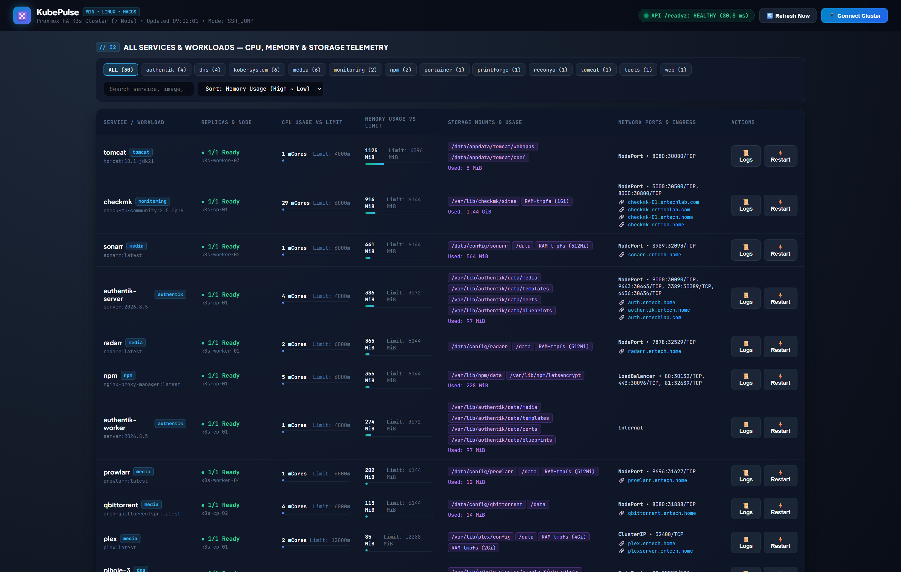
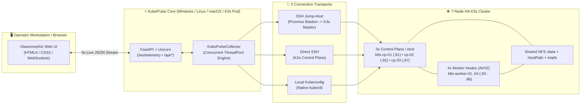

<div align="center">

# ☸️ KubePulse
### Next-Generation Cross-Platform Remote K3s & Kubernetes Telemetry Command Center

[](https://github.com/digdast/kubepulse)
[](https://www.python.org/)
[](https://fastapi.tiangolo.com/)
[](https://github.com/digdast/kubepulse)

**Real-Time CPU (`mCores`), Memory (`MiB/GiB`), and Storage (`Root Disk / NFS / HostPath / PVC / tmpfs`) Telemetry with 1-Click Container Logs & Zero-Downtime Rolling Restarts.**

---



</div>

---

## ⚡ Overview

**KubePulse** is a high-performance, dark-glassmorphic graphical observability and operations suite engineered for **K3s** and **Kubernetes** clusters. Designed to run natively on **Windows**, **Linux**, **macOS**, **Docker**, or directly inside **Kubernetes (`monitoring/kubesonarr`)**, it eliminates the need for heavyweight Prometheus/Grafana stacks when you want instant, sub-100ms visibility into every node, pod, service, and storage mount.

---

## 🖼️ High-Resolution Interface Gallery

### 1. Full Telemetry Command Center (`7-Node HA K3s Cluster`)
Real-time executive KPI gauges across **52 vCPUs**, **88 GiB RAM**, **Node Root Storage**, and **1.5 TB Shared NFS (`/data`)**, paired with live Top Memory & Top CPU service bar charts:


---

### 2. Per-Service CPU, Memory & Storage Telemetry Matrix
Interactive workload matrix with instant namespace filtering (`ALL`, `authentik`, `dns`, `kube-system`, `media`, `monitoring`, `npm`, `portainer`, `tomcat`, `web`), multi-column sorting (`Memory`, `CPU`, `Storage`, `Name`), real-time utilization bars against Kubernetes limits, HostPath/NFS directory byte sizing (`du -sb`), and clickable Ingress routes:



---

### 3. Multi-Node Hardware & Storage Topology (`3 Control-Plane/etcd + 4 Workers`)
Live hardware telemetry cards for every control-plane and worker node showing IP addresses, roles (`control-plane, etcd` / `worker`), vCPU millicore load, RAM utilization, and root disk usage:


---

### 4. Live Container Log Streamer & Rolling Restart Controls
1-click live container stdout/stderr log inspection and zero-downtime `kubectl rollout restart` execution directly from the graphical dashboard:


---

## 🏗️ System Architecture



---

## 🚀 Key Capabilities

| Capability | Technical Implementation |
| :--- | :--- |
| **Cross-Platform Execution** | Runs identically on **Windows 10/11**, **Linux**, **macOS**, **Docker**, and inside **K3s** (`NodePort 30789`). |
| **Agentless Remote SSH Jump-Host** | Connects through a Proxmox VE or Bastion host directly into a K3s control plane—zero local `kubectl` installation or kubeconfig certificate copying required. |
| **Parallel Telemetry Pipeline** | Executes `kubectl get`, `kubectl top nodes/pods`, `/readyz` latency probes, `df -B1`, and parallel `du -sb` volume inspections concurrently in `< 100ms` API latency. |
| **Deep Storage Observability** | Tracks per-node root disk capacity, shared NFS `/data` pool usage, `PersistentVolumeClaims`, `RAM-tmpfs` mounts, and per-service directory consumption. |
| **Active Day-2 Operations** | Includes 1-click **Live Container Logs** (`--all-containers=true`) and 1-click **Zero-Downtime Rolling Restarts** (`kubectl rollout restart`). |

---

## 🛠️ Quick Start

### 1. Windows (1-Click Launcher)
Double-click `run.bat` or run from PowerShell:
```powershell
git clone https://github.com/digdast/kubepulse.git
cd kubepulse
.\run.bat
```

### 2. Linux & macOS
```bash
git clone https://github.com/digdast/kubepulse.git
cd kubepulse
chmod +x run.sh
./run.sh
```

### 3. Deploy Natively Inside K3s / Kubernetes (`monitoring/kubesonarr`)
```bash
kubectl apply -f k8s-kubesonarr.yaml
```
- **NodePort Access**: `http://<any-k3s-node-ip>:30789`
- **Ingress Hostnames**: `http://kubesonarr.local` / `http://kubesonarr.ertechlab.com`

### 4. Docker Compose
```bash
docker compose up -d --build
```
Open **http://localhost:7890** in your browser.
