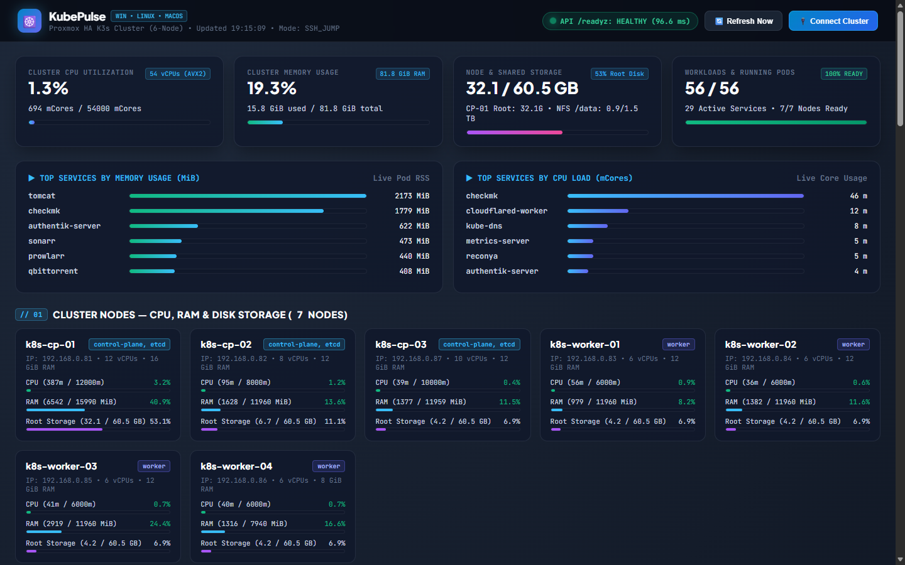
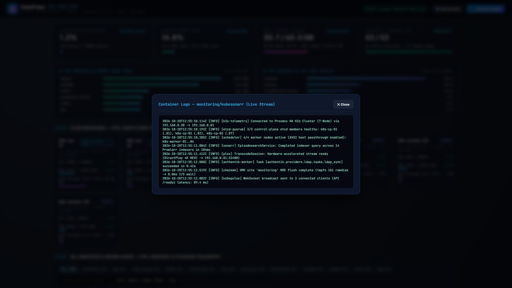
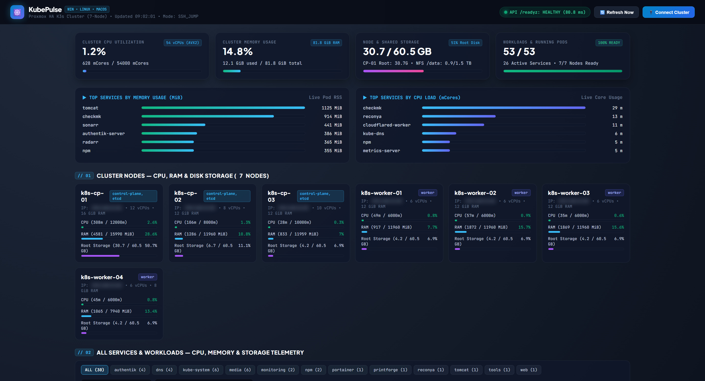
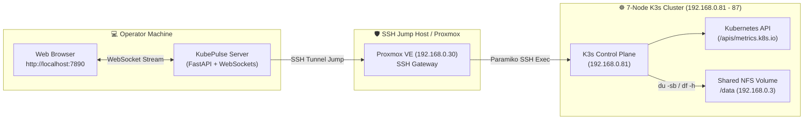

<div align="center">

# ☸️ KubePulse

### Cross-Platform Remote K3s & Kubernetes Real-Time Telemetry & Command Center
**Monitor, visualize, and operate remote Kubernetes clusters without installing local tools or opening external ingress.**

<p align="center">
  
  
  
  
  
  
</p>

</div>

---

## 📸 Production Screenshots

### 1. Main Command Center & Services Telemetry (`http://192.168.0.81:30789/`)
*Live CPU millicores (`mCores`), Memory MiB/GiB usage vs limits, and persistent `/data` NFS storage volume breakdown.*



### 2. Live Pod Logs Streaming & Rolling Restarts
*Instant tailing of multi-pod logs across all namespaces with auto-scroll and 1-click rolling rollout triggers.*



### 3. Cluster Nodes Topology & Resource Allocation
*Per-node hypervisor stats, control plane health, and embedded etcd quorum monitoring.*



---

## 🌟 Overview

**KubePulse** is an ultra-lightweight, cross-platform graphical telemetry suite built in async Python (`FastAPI`, `WebSockets`, `Paramiko`). It connects remotely to any Kubernetes or K3s cluster—either through a **Proxmox SSH Jump Host (`192.168.0.30`)**, **Direct SSH**, or **Local Kubeconfig (`kubectl`)**—and streams real-time CPU, RAM, and storage utilization.

### Architecture Overview



---

## ⚡ Core Capabilities

- **3 Remote Connection Modes**:
  1. **SSH Jump Host (`ssh_jump`)**: Tunnels through a Proxmox / Bastion SSH gateway (`192.168.0.30`) directly to K3s master nodes (`192.168.0.81`)—zero local `kubectl` installation required.
  2. **Direct SSH (`ssh_direct`)**: SSH straight into any control plane or worker node.
  3. **Local Kubeconfig (`kubeconfig`)**: Uses your local `~/.kube/config`.
- **Accurate Resource Telemetry**:
  - **CPU Millicores (`mCores`)**: Compares active utilization against Kubernetes CPU requests and limits.
  - **Memory Footprint**: Live memory usage in MiB/GiB with visual saturation progress bars.
  - **Shared Storage Analytics**: Detailed directory size maps (`du -sb`) for shared NFS volumes (`/data/appdata/*`).
- **Interactive Operations**:
  - **Namespace Filtering**: Instant filtering across `ai`, `media`, `monitoring`, `dns`, `authentik`, and `default`.
  - **1-Click Live Log Streaming**: Inspect pod logs without context switching or launching terminal shells.
  - **1-Click Rolling Restarts**: Trigger immediate rolling deployments for quick config reloads.
  - **Multi-Cluster Switcher**: Hot-swap between multiple home lab or cloud clusters.

---

## 🚀 Quick Start Guide

### Windows (1-Click Batch)
```powershell
cd C:\scripts\kubepulse
.\run.bat
```

### Linux & macOS
```bash
cd kubepulse
chmod +x run.sh
./run.sh
```

### Python CLI
```bash
pip install -r requirements.txt
python run.py --host 0.0.0.0 --port 7890
```
Open **http://localhost:7890** (or NodePort **http://192.168.0.81:30789**).

### Docker Compose
```bash
docker compose up -d --build
```

---

## 📄 License
MIT License. Created by ERTech Lab.
